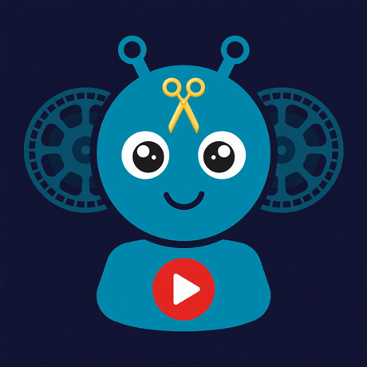
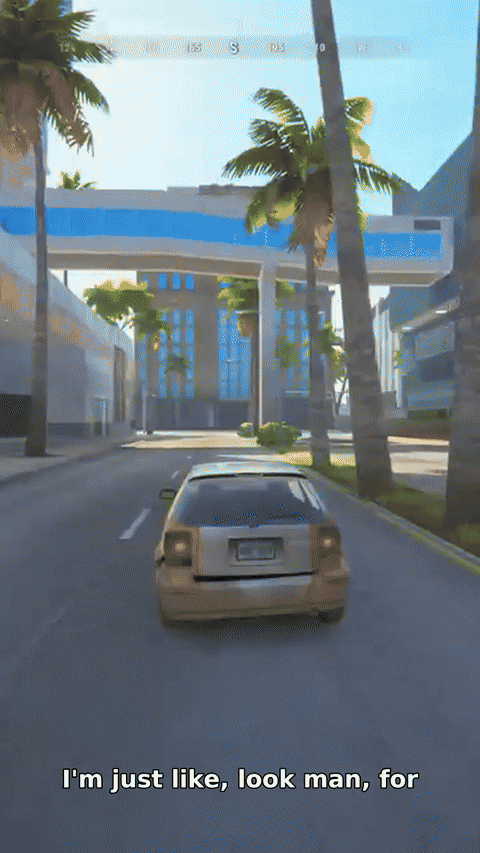

# Hey, I'm Rakib 👋

**Building open-source AI video tools — so any creator can turn long videos into Shorts, free.**

---

> Good video tools shouldn't sit behind a paywall. If you shot a video, you should be able to turn it into Shorts — no credits, no subscriptions, no locked features. So I'm building those tools in the open, free for everyone, and they run on your own machine.

## 🚀 Featured flagship: ShortCutter

**Turn a long video — or a live stream — into vertical Shorts, free, on your own machine.**

ShortCutter finds the best moments in a long video (or a live stream), cuts them into captioned vertical Shorts, adds thumbnails, checks them for copyright risk — and can post them for you.

- ✂️ **Best-moment Shorts** from any long video or YouTube link, with Whisper captions
- 📺 **Live viral-moment catcher** — watches a YouTube live, cuts the spike moment, emails you the clip
- 🎯 **Face-tracking reframe** — the 9:16 window follows the speaker
- 🖼️ **Auto thumbnails** for every clip
- 🛡️ **Copyright check + fixer** — fixes only the risky audio, video stays bit-identical
- 📤 **Auto-post** to YouTube, Instagram, TikTok & Facebook (dry-run by default, with scheduling)

📦 Repo: [github.com/fromrakib/ShortCutter](https://github.com/fromrakib/ShortCutter) · 🎬 [Try the live demo](https://muse.ai/s/shortcutter-ui-demo-ms6xpxw0ekxixis/3XMn8v9sTV7sJE86wdRGa6XJWhVJpqiB5rIvIHk5epA) · ☕ [Support it on Buy Me a Coffee](https://www.buymeacoffee.com/shortcutter)

## 🛠️ What I'm building

Right now, all my focus is **ShortCutter v0.6** — the face-tracking reframe, the live viral-moment catcher, and the copyright fixer. One tool, free and open, that takes a long video all the way to posted Shorts.

**Built with:**     

## 🔗 Links

- [ShortCutter on GitHub](https://github.com/fromrakib/ShortCutter)
- [ShortCutter UI demo](https://muse.ai/s/shortcutter-ui-demo-ms6xpxw0ekxixis/3XMn8v9sTV7sJE86wdRGa6XJWhVJpqiB5rIvIHk5epA)
- [Buy Me a Coffee](https://www.buymeacoffee.com/shortcutter)
